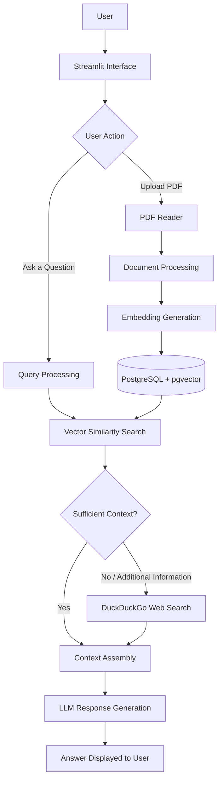

# 🌌 AuroraRAG — Intelligent Retrieval-Augmented Generation

<p align="center">
  
</p>

<p align="center">
  <strong>An AI-powered knowledge assistant that combines document retrieval, vector search, large language models, and web search to deliver context-aware answers.</strong>
</p>

<p align="center">
  <a href="https://github.com/keshavkapill/AuroraRAG"></a>
  
  
  
  
  
</p>

<p align="center">
  <a href="#-overview">Overview</a> •
  <a href="#-key-features">Features</a> •
  <a href="#-system-architecture">Architecture</a> •
  <a href="#-installation-and-setup">Installation</a> •
  <a href="#-how-it-works">Workflow</a> •
  <a href="#-author">Author</a>
</p>


https://github.com/user-attachments/assets/5f882af8-25d0-43cb-86cf-d9144a035c83


---

## 📌 Overview

**AuroraRAG** is an AI-powered question-answering application built around the concept of **Retrieval-Augmented Generation (RAG)**. It combines a document knowledge base, vector similarity search, and a large language model to produce responses grounded in relevant information.

Instead of relying exclusively on the information learned during model training, AuroraRAG retrieves relevant context from a local knowledge base and can use web search when additional information is required.

The application is designed to make knowledge discovery more interactive by allowing users to upload PDF documents, ask questions in natural language, and receive context-aware responses through a Streamlit interface.

### 🎯 Problem Statement

Traditional language models may produce incomplete, outdated, or unsupported answers when they lack access to relevant information. Searching large documents manually can also be time-consuming and inefficient.

AuroraRAG addresses these challenges by integrating document retrieval and external web search into a unified question-answering workflow.

### 💡 Proposed Approach

- **Document understanding:** Process PDF files and make their content available for retrieval.
- **Vector-based retrieval:** Represent document content as embeddings and search for semantically relevant information.
- **Context-aware generation:** Use a language model to generate answers using the retrieved context.
- **Web search integration:** Retrieve supplementary information from the web when the local knowledge base is insufficient.
- **Interactive interface:** Provide a simple interface for document uploads and natural-language queries.

### 🌟 Project Objectives

- Build an interactive AI-powered knowledge assistant.
- Explore the practical implementation of Retrieval-Augmented Generation.
- Integrate vector databases with language models.
- Enable dynamic document ingestion and retrieval.
- Combine private knowledge sources with external information retrieval.
- Understand how AI applications can connect retrieval systems, databases, and user interfaces.

---

## ✨ Key Features

<table>
  <tr>
    <td width="50%">
      <h3>📄 Dynamic PDF Ingestion</h3>
      Add PDF documents to the knowledge base and make their content available for subsequent queries.
    </td>
    <td width="50%">
      <h3>🧠 Semantic Retrieval</h3>
      Use embeddings and vector similarity search to retrieve relevant information based on meaning rather than exact keyword matches.
    </td>
  </tr>
  <tr>
    <td width="50%">
      <h3>🤖 LLM-Powered Responses</h3>
      Generate natural-language answers using the language model and the context retrieved for a query.
    </td>
    <td width="50%">
      <h3>🌐 Web Search Fallback</h3>
      Supplement local knowledge with web search when relevant information is not available in the document collection.
    </td>
  </tr>
  <tr>
    <td width="50%">
      <h3>🗄️ Persistent Vector Storage</h3>
      Use PostgreSQL with pgvector to store and retrieve vector representations of document content.
    </td>
    <td width="50%">
      <h3>🖥️ Streamlit Interface</h3>
      Interact with the application through a user-friendly interface without requiring a separate frontend application.
    </td>
  </tr>
</table>

---

## 🛠️ Technology Stack

| Technology | Purpose |
|---|---|
| Python | Application logic and backend development |
| Streamlit | Interactive web interface |
| OpenAI API | Language-model responses and text embeddings |
| PostgreSQL | Database infrastructure |
| pgvector | Vector storage and similarity search |
| PDF Reader | Extracting information from uploaded PDF documents |
| DuckDuckGo Search | Retrieving relevant external web information |
| Docker | Running the PostgreSQL/pgvector database container |
| SQLAlchemy / Psycopg | Database connectivity, depending on the configured dependencies |

---

## 🏗️ System Architecture

AuroraRAG follows a retrieval-augmented workflow in which user questions are answered using retrieved information rather than relying solely on the language model's internal knowledge.



### 🔍 Architecture Components

**1. User Interface**

Streamlit provides the application interface for entering questions, supplying an API key where configured, uploading documents, and viewing generated answers.

**2. Document Processing**

Uploaded PDFs are processed by a PDF reader so their textual content can be incorporated into the knowledge base.

**3. Embedding Generation**

Text is converted into numerical vector representations. These embeddings enable semantic similarity comparisons between user queries and stored document content.

**4. Vector Database**

PostgreSQL with pgvector provides storage and similarity-search functionality for the document embeddings.

**5. Retrieval and Web Search**

The retrieval component searches the local knowledge base for relevant information. Web search can provide supplementary context when local information does not adequately answer a question.

**6. Language Model**

The configured language model combines the available context with the user's question to generate a natural-language response.

---

## 🔄 How It Works

AuroraRAG can be understood through two primary workflows.

### Workflow A — Building the Knowledge Base

1. The user uploads a PDF document.
2. The PDF reader extracts its content.
3. The application prepares the extracted information for retrieval.
4. Text embeddings are generated using the configured embedding model.
5. Document representations are stored in PostgreSQL with pgvector.
6. The uploaded information becomes available for subsequent queries.

### Workflow B — Answering a Question

1. The user submits a question through the Streamlit interface.
2. The system searches the local vector database for relevant information.
3. Retrieved content is used to provide context for the language model.
4. If additional information is needed, the application can invoke web search.
5. The language model generates a response based on the available context.
6. The answer is displayed in the interface.

*The exact retrieval order, fallback conditions, and context-selection logic depend on the application's implementation and configuration.*

---

## ⚙️ Installation and Setup

Follow the steps below to prepare the environment and run AuroraRAG locally.

### Prerequisites

Before getting started, ensure that you have:

- Python 3.7 or later; a currently supported Python version compatible with the project's dependencies is preferable.
- Git installed on your system.
- Docker Desktop installed and running.
- An OpenAI API key or a compatible LLM provider's API key.
- PostgreSQL with the pgvector extension.
- A code editor such as Visual Studio Code or Cursor.

### Step 1 — Clone the Repository

Open a terminal or Command Prompt and execute:

```bash
git clone https://github.com/keshavkapill/AuroraRAG.git
```

Navigate into the project directory:

```bash
cd AuroraRAG
```

### Step 2 — Create a Virtual Environment

Create an isolated Python environment:

```bash
python -m venv venv
```

Activate it on Windows:

```bash
venv\Scripts\activate
```

On macOS or Linux:

```bash
source venv/bin/activate
```

### Step 3 — Install Dependencies

If the repository contains a `requirements.txt` file, install its dependencies:

```bash
python -m pip install --upgrade pip
pip install -r requirements.txt
```

If the project does not contain this file, install the dependencies specified by its actual application imports and setup instructions.

### Step 4 — Start PostgreSQL with pgvector

Ensure Docker Desktop is running, then start a pgvector-enabled PostgreSQL container:

```bash
docker run -d ^
  -e POSTGRES_DB=ai ^
  -e POSTGRES_USER=ai ^
  -e POSTGRES_PASSWORD=ai ^
  -e PGDATA=/var/lib/postgresql/data/pgdata ^
  -v pgvolume:/var/lib/postgresql/data ^
  -p 5532:5432 ^
  --name pgvector ^
  phidata/pgvector:16
```

The above command uses Windows Command Prompt line continuations. If using PowerShell, replace `^` with the PowerShell backtick, or run the command on a single line.

The database connection URL for this configuration is:

```text
postgresql+psycopg://ai:ai@localhost:5532/ai
```

**Important:** These are example development credentials. Do not reuse them in a publicly exposed or production database. If a container named `pgvector` already exists, inspect it before attempting to create another container with the same name.

### Step 5 — Configure the API Key

Create or configure the environment variables required by your application.

For example, in Windows Command Prompt:

```cmd
set OPENAI_API_KEY=your_openai_api_key
```

For macOS or Linux:

```bash
export OPENAI_API_KEY="your_openai_api_key"
```

Replace the example value with your actual key.

If AuroraRAG accepts the API key directly through its Streamlit interface, follow that interface instead. Never commit API keys, passwords, or other secrets to GitHub.

### Step 6 — Launch AuroraRAG

Run the Streamlit entry-point file configured in your repository. For example, if the entry point is `rag_database_routing.py`, execute:

```bash
streamlit run rag_database_routing.py
```

If your entry-point filename is different, replace it with the actual Python application file.

Streamlit will display a local URL, typically:

```text
http://localhost:8501
```

Open that address in your browser to interact with the application.

---

## 🔐 Configuration and Security

For a reliable local development setup, keep the following considerations in mind:

- **API key protection:** Store secrets in environment variables or an untracked `.env` file.
- **Database configuration:** Keep the database connection string consistent with your PostgreSQL host, port, credentials, and database name.
- **Persistent storage:** Use a Docker volume to preserve database files across container restarts.
- **Dependency compatibility:** Confirm that the installed packages support the Python version and APIs used by the application.
- **Answer verification:** Validate generated responses against retrieved documents and trustworthy external sources.
- **Production deployment:** Use appropriate authentication, database access controls, secret management, and network restrictions before exposing the application publicly.

---

## 📊 Expected Outcomes

AuroraRAG is designed to demonstrate the practical value of combining document retrieval and language-model generation.

Its intended outcomes include:

- Faster access to information stored in PDF documents.
- Natural-language interaction with a document knowledge base.
- Semantic retrieval of relevant information.
- Supplementary information discovery through web search.
- Context-aware responses supported by retrieved information.
- A practical foundation for experimenting with AI assistants and RAG pipelines.

*These are intended capabilities, not measured performance claims. Response quality depends on document quality, retrieval settings, model selection, and the availability of relevant sources.*

---

## 🚀 Potential Future Improvements

AuroraRAG can be extended with additional capabilities as the project evolves.

- **Multi-format ingestion:** Support DOCX, TXT, Markdown, and HTML documents.
- **Advanced retrieval:** Introduce hybrid keyword and vector search, reranking, and configurable retrieval thresholds.
- **Source citations:** Display document names, page numbers, and source URLs alongside generated answers.
- **Conversation memory:** Maintain conversational context across multiple questions.
- **Document management:** Enable document removal, replacement, and collection management.
- **Evaluation framework:** Measure retrieval relevance, answer correctness, latency, and hallucination rates.
- **Observability:** Add structured logging, error tracking, and performance monitoring.
- **Deployment:** Package the application for deployment using Docker and a suitable cloud platform.
- **Improved security:** Add authentication, access controls, and safer handling of sensitive documents.

---

## 👨‍💻 Author

<p align="center">
  <strong>Keshav Kapil</strong><br/>
  B.Tech Computer Science and Engineering
</p>

<p align="center">
  Interested in software engineering, AI-powered applications, cloud computing, and building practical technology solutions.
</p>

<p align="center">
  <a href="https://github.com/keshavkapill">
    
  </a>
  <a href="https://www.linkedin.com/in/keshavkapil15/">
    
  </a>
</p>

<p align="center">
  <a href="https://github.com/keshavkapill/AuroraRAG">
    
  </a>
</p>

---
---

<p align="center">
  <strong>Made with ❤️ by <a href="https://github.com/keshavkapill">Keshav Kapil</a></strong>
</p>

<p align="center">
  <a href="https://github.com/keshavkapill">GitHub</a> •
  <a href="https://www.linkedin.com/in/keshavkapil15/">LinkedIn</a> •
  <a href="https://github.com/keshavkapill/AuroraRAG">AuroraRAG Repository</a>
</p>

<p align="center">
  <em>Build with purpose. Engineer with precision. Keep learning.</em>
</p>
